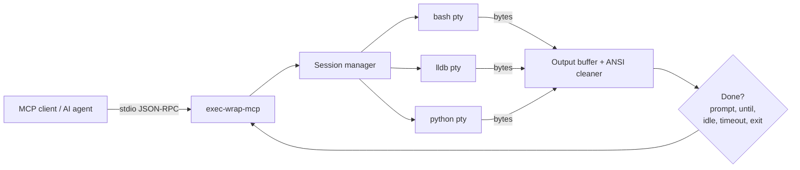

<div align="center">

# exec-wrap-mcp

**Give your AI agent a terminal that remembers.**

An [MCP](https://modelcontextprotocol.io) server that keeps interactive programs alive between tool calls:
shells, debuggers, REPLs, database clients, anything that shows a prompt.

[](https://github.com/Muthu-Palaniyappan-OL/exec-wrap-mcp/actions/workflows/ci.yml)
[](https://github.com/Muthu-Palaniyappan-OL/exec-wrap-mcp/releases)
[](https://pkg.go.dev/github.com/Muthu-Palaniyappan-OL/exec-wrap-mcp)
[](LICENSE)


</div>

---

## The problem

Most "run a command" tools start a fresh process for every call, so everything the program knew is gone:

```text
call 1:  export ONE=1        -> new bash, sets ONE, bash exits
call 2:  echo $ONE           -> new bash, prints an empty line   :(
```

That breaks `cd`, virtualenvs, `ssh` sessions, `gdb` breakpoints, open database transactions, a Python REPL full of loaded data, and every other workflow where state is the point.

## The fix

`exec-wrap-mcp` launches a program **once**, keeps it running, and lets the agent talk to it over as many calls as it needs:

```text
launch  {"command": "/bin/bash"}              -> session_id: s_1a2b3c4d
send    {"session_id": "s_1a2b3c4d", "input": "export ONE=1"}
send    {"session_id": "s_1a2b3c4d", "input": "echo $ONE"}   -> 1          :)
```

It is not limited to shells. If a program reads lines from a terminal and prints a prompt, it works:

| Wrap this | So your agent can |
| --- | --- |
| `/bin/bash`, `zsh`, `sh`, `cmd.exe`, `pwsh` | keep `cd`, env vars, virtualenvs and background jobs across calls |
| `gdb`, `lldb` | set breakpoints, step, inspect memory over many turns |
| `python3`, `node` | build up state in a REPL, load a dataset once and explore it |
| `psql`, `mysql`, `sqlite3` | run a transaction across several calls |
| `ssh host`, `docker exec -it c sh` | work on a remote box without reconnecting each time |
| `irb`, `ghci`, `redis-cli`, `rails console`, ... | anything prompt-driven |

## Quick start

### 1. Install

```sh
# Go 1.25+
go install github.com/Muthu-Palaniyappan-OL/exec-wrap-mcp@latest
```

or download a binary for Linux, macOS or Windows (amd64 and arm64) from the
[Releases page](https://github.com/Muthu-Palaniyappan-OL/exec-wrap-mcp/releases) and put it on your `PATH`.
Each release ships a `checksums.txt`.

### 2. Add it to your MCP client

The server speaks MCP over stdio, so every client uses the same entry:

```json
{
  "mcpServers": {
    "exec-wrap": {
      "command": "exec-wrap-mcp"
    }
  }
}
```

<details>
<summary>Where that goes</summary>

| Client | How |
| --- | --- |
| Claude Code | `claude mcp add exec-wrap -- exec-wrap-mcp` |
| Claude Desktop | `claude_desktop_config.json` |
| Kiro | `.kiro/settings/mcp.json` (workspace) or `~/.kiro/settings/mcp.json` (user) |
| Cursor | `.cursor/mcp.json` |
| VS Code | `.vscode/mcp.json` (use the `servers` key instead of `mcpServers`) |

</details>

### 3. Ask your agent

> "Start a bash session, activate the virtualenv in `./venv`, run the test suite, and tell me which test fails first."
>
> "Launch `lldb` on `./a.out`, break on `main`, run, and show me the backtrace after the crash."

## Tools

| Tool | What it does |
| --- | --- |
| `launch` | Start a program as a session. Returns `session_id` and the initial output. |
| `send` | Write input, flush it, and return the output it produced. |
| `read` | Fetch pending output without sending anything (after a timeout, or for background output). |
| `signal` | `interrupt` (Ctrl-C), `eof` (Ctrl-D), `terminate`, `kill`, `suspend`. |
| `resize` | Change the terminal size of a pty session. |
| `list` | Show all sessions, their state and unread output. |
| `kill` | Exit a session: graceful first, forced after a grace period. |

Many sessions can run side by side; each has its own state. Errors come back as MCP tool errors with a stable code at the start of the message: `invalid_argument`, `not_found`, `limit_reached`, `spawn_failed`, `not_allowed`, `busy`, `session_exited`, `unsupported`, `internal`.

Every result is both structured JSON and readable text. A `send` result looks like this:

```json
{
  "output": "1",
  "done_reason": "prompt",
  "exited": false,
  "last_exit_status": 0,
  "truncated": false,
  "dropped_bytes": 0,
  "elapsed_ms": 31
}
```

### `launch` options

| Field | Default | Meaning |
| --- | --- | --- |
| `command` | required | Executable, run directly. No shell string is involved. |
| `args`, `cwd`, `env` | | Arguments, working directory, extra environment. |
| `preset` | inferred | `bash zsh sh python gdb lldb psql node cmd powershell none`. See below. |
| `prompt_regex` | from preset | Regexp matching the end of the output when the program waits for input. |
| `tty` | `true` | Use a pseudo-terminal. `false` uses plain pipes. |
| `rows`, `cols` | 40 x 200 | Terminal size. |
| `startup_wait_ms` | 1000 | How long to wait for the first prompt. |

### `send` options

| Field | Default | Meaning |
| --- | --- | --- |
| `input` | required | Text to write. A newline is appended unless you pass `newline: false`. Multi-line input is fine. |
| `wait.timeout_ms` | 30000 | Hard limit (max 600000). |
| `wait.idle_ms` | 300 (5000 when a prompt is known) | Return after this long without new output. |
| `wait.prompt_regex` | session prompt | Override the prompt for this call. |
| `wait.until_regex` | | Return as soon as the output matches. |
| `strip_ansi` | `true` | Remove terminal escape sequences. |
| `max_bytes` | 65536 | Cap on returned output (max 1 MiB). Keeps the first 25% and last 75%. |
| `no_wait` | `false` | Write and return immediately, collect later with `read`. |

## How it knows a command has finished

An interactive program never says "done", so `send` returns on the **first** of these:

1. **`exited`**: the process ended. You get the remaining output and the exit code.
2. **`until`**: your `until_regex` matched.
3. **`prompt`**: the program printed its prompt again. This is the normal, precise case.
4. **`idle`**: no new output for `idle_ms`. The fallback for programs without a known prompt.
5. **`timeout`**: `timeout_ms` elapsed. The process keeps running; call `read` or `signal`.

For shells, `launch` installs a private prompt marker (an ASCII record-separator wrapped around the last exit status), so a command that happens to print `$ ` can never be mistaken for the prompt. The marker is stripped from the output and surfaced as `last_exit_status`. Bash and zsh are started without line editing and with terminal echo off, so the output you get back is clean.

Built-in presets:

| Preset | Detected as | Prompt |
| --- | --- | --- |
| `bash`, `sh`, `zsh` | `bash`, `dash`, `zsh`, ... | private marker |
| `python` | `python*`, `ipython` | `>>> ` / `... ` |
| `gdb`, `lldb` | `gdb`, `lldb` | `(gdb) ` / `(lldb) ` |
| `psql` | `psql` | `db=# ` and friends |
| `node` | `node` | `> ` |
| `cmd`, `powershell` | `cmd.exe`, `pwsh` | `C:\dir>` / `PS C:\dir> ` |
| `none` | anything else | idle detection |

Wrapping something else? Pass `prompt_regex`, e.g. `"mysql> \\z"`, or leave it and rely on idle detection.

## Platform support

| OS | Terminal | Notes |
| --- | --- | --- |
| Linux, macOS (and other unix) | pseudo-terminal | Each session is its own process group; signals reach the whole job. |
| Windows 10 1809+ | ConPTY | Falls back to pipes if ConPTY is not available. |

It is a single static binary (`CGO_ENABLED=0`). CI runs the full end-to-end suite on Ubuntu, macOS and Windows.

## Server flags

```text
--max-sessions 16      maximum concurrent sessions
--idle-ttl 30m         kill sessions nobody touched for this long (0 disables)
--max-buffer 4194304   unread output bytes kept per session (oldest dropped first)
--allow-command GLOB   only allow matching executables (repeatable), e.g. --allow-command '/usr/bin/*'
--clean-env            give children only PATH, HOME, USER, LANG, TERM
--log-io               log session input and output to stderr (may expose secrets)
--version
```

Children run with `TERM=dumb` and `PAGER=cat` by default so tools do not open pagers or full-screen UIs. Override per session with `env`.

## Security

**This server runs arbitrary programs as your user.** That is the feature. Treat it like giving the agent a shell.

- stdio only: no network listener, no files, no ports. The only caller is the client that spawned it.
- `launch` takes an executable and arguments, never a shell string, so the server adds no injection surface of its own.
- `--allow-command` restricts which executables can be started. The default is allow-all.
- Limits on sessions, buffer size, wait time and idle lifetime keep a runaway session from growing without bound.
- Input and output are not logged unless you pass `--log-io`.
- Keep human approval of tool calls turned on in your MCP client for anything you do not fully trust.
- There is no sandbox. For untrusted workloads run the server in a container or VM.

Report vulnerabilities as described in [SECURITY.md](SECURITY.md).

## Under the hood



Each session owns a pseudo-terminal, a reader goroutine feeding a bounded buffer, and a waiter that records the exit code. `send` writes input, then watches the buffer until one of the completion conditions holds. The design is written up in [SPEC.md](SPEC.md).

## Development

```sh
git clone https://github.com/Muthu-Palaniyappan-OL/exec-wrap-mcp
cd exec-wrap-mcp
go build ./...
go test -race ./...          # unit tests + end-to-end tests that drive the real binary over MCP
```

See [CONTRIBUTING.md](CONTRIBUTING.md). Releases follow [Semantic Versioning](https://semver.org); while the version is `0.x`, tool schemas may still change between minor versions.
Dependencies are kept current by Dependabot, which opens a pull request for every update and merges it automatically once CI passes (security fixes included) (see [docs/RELEASING.md](docs/RELEASING.md)).

## FAQ

**Why not just run `bash -c` per call?** Because state dies with the process. See the top of this file.

**Can it drive vim or htop?** No. It reads a line-oriented stream. Full-screen terminal UIs would need a screen emulator and are out of scope.

**What if a command runs for ten minutes?** `send` returns `timeout` (default 30 s, up to 10 min). The process keeps running; poll with `read`, or interrupt with `signal`.

**What happens when the client disconnects?** All sessions and their process trees are terminated.

**Does it work in Docker?** Yes. Use `launch` with `docker` and `["exec","-it","<container>","sh"]`, or run the server inside the container.

## License

[MIT](LICENSE)
