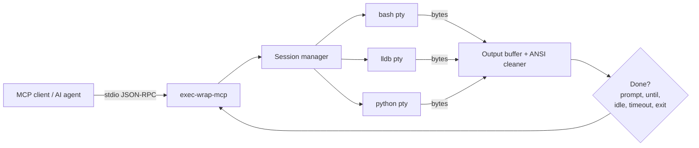

<div align="center">

# exec-wrap-mcp

**Give your AI agent a terminal that remembers.**

An [MCP](https://modelcontextprotocol.io) server that keeps interactive programs alive between tool calls:
shells, debuggers, REPLs, database clients, anything that shows a prompt.

[](https://github.com/Muthu-Palaniyappan-OL/exec-wrap-mcp/actions/workflows/ci.yml)
[](https://github.com/Muthu-Palaniyappan-OL/exec-wrap-mcp/releases)
[](https://pkg.go.dev/github.com/Muthu-Palaniyappan-OL/exec-wrap-mcp)
[](LICENSE)


</div>

---

## The problem

Most "run a command" tools start a fresh process for every call, so everything the program knew is gone:

```text
call 1:  export ONE=1        -> new bash, sets ONE, bash exits
call 2:  echo $ONE           -> new bash, prints an empty line   :(
```

That breaks `cd`, virtualenvs, `ssh` sessions, `gdb` breakpoints, open database transactions, a Python REPL full of loaded data, and every other workflow where state is the point.

## The fix

`exec-wrap-mcp` launches a program **once**, keeps it running, and lets the agent talk to it over as many calls as it needs:

```text
launch  {"command": "/bin/bash"}                          -> s_1a2b3c4d
send    {"session_id": "s_1a2b3c4d", "input": "export ONE=1"}   -> ok
send    {"session_id": "s_1a2b3c4d", "input": "echo $ONE"}      -> 1
```

It is not limited to shells. If a program reads lines from a terminal and prints a prompt, it works:

| Wrap this | So your agent can |
| --- | --- |
| `/bin/bash`, `zsh`, `sh`, `cmd.exe`, `pwsh` | keep `cd`, env vars, virtualenvs and background jobs across calls |
| `gdb`, `lldb` | set breakpoints, step, inspect memory over many turns |
| `python3`, `node` | build up state in a REPL, load a dataset once and explore it |
| `psql`, `mysql`, `sqlite3` | run a transaction across several calls |
| `ssh host`, `docker exec -it c sh` | work on a remote box without reconnecting each time |
| `irb`, `ghci`, `redis-cli`, `rails console`, ... | anything prompt-driven |

## Quick start

### 1. Install

```sh
# Go 1.25+
go install github.com/Muthu-Palaniyappan-OL/exec-wrap-mcp@latest
```

or download a binary for Linux, macOS or Windows (amd64 and arm64) from the
[Releases page](https://github.com/Muthu-Palaniyappan-OL/exec-wrap-mcp/releases) and put it on your `PATH`.
Each release ships a `checksums.txt`.

### 2. Add it to your MCP client

The server speaks MCP over stdio, so every client uses the same entry:

```json
{
  "mcpServers": {
    "exec-wrap": {
      "command": "exec-wrap-mcp"
    }
  }
}
```

<details>
<summary>Where that goes</summary>

| Client | How |
| --- | --- |
| Claude Code | `claude mcp add exec-wrap -- exec-wrap-mcp` |
| Claude Desktop | `claude_desktop_config.json` |
| Kiro | `.kiro/settings/mcp.json` (workspace) or `~/.kiro/settings/mcp.json` (user) |
| Cursor | `.cursor/mcp.json` |
| VS Code | `.vscode/mcp.json` (use the `servers` key instead of `mcpServers`) |

</details>

### 3. Ask your agent

> "Start a bash session, activate the virtualenv in `./venv`, run the test suite, and tell me which test fails first."
>
> "Launch `lldb` on `./a.out`, break on `main`, run, and show me the backtrace after the crash."

## Tools

Four tools, kept small on purpose: schemas and replies cost LLM tokens.

| Tool | What it does |
| --- | --- |
| `launch` | Start a program as a session. Returns the session id and the first output. Optional `input` runs a first command in the same call. |
| `send` | Send `input` and return the reply. With no `input` it reads more output. With `key` (`ctrl-c`, `ctrl-d`, `ctrl-z`, `term`, `kill`) it sends a key or signal instead. |
| `kill` | End a session. Optional: idle sessions expire on their own. |
| `list` | One line per session: id, command, state. |

Replies are plain text: the output, and a one-line note only when something is unusual.

```text
send {"input": "echo $ONE"}              ->  1
send {"input": "export ONE=1"}           ->  ok
send {"input": "ls /nope"}               ->  ls: /nope: No such file or directory
                                             [exit 1]
send {"input": "sleep 60", "wait_ms": 500} ->  [timeout: still running; send with no input to read more]
```

Notes you may see: `[exit N]`, `[exited N]`, `[killed by SIGKILL]`, `[timeout ...]`, `[idle ...]`, `[starting ...]`, `[truncated]`. Errors carry a stable code first: `invalid_argument`, `not_found`, `session_closed`, `limit_reached`, `spawn_failed`, `not_allowed`, `busy`, `session_exited`, `unsupported`, `internal`. A session that was killed, expired or exited reports that (`session_closed: session s_x was ended by kill; launch a new one`) instead of a bare "not found". Start the server with `--structured` if your client wants machine-readable `structuredContent` as well.

### `launch` arguments

| Field | Meaning |
| --- | --- |
| `command` (required) | Executable, run directly. No shell string is involved. |
| `args`, `cwd`, `env` | Arguments, working directory, extra environment. |
| `input` | First input, sent once the program is ready. |
| `wait_ms` | How long to wait for the program to become ready and answer (default 30000). |
| `preset` | `bash zsh sh python gdb lldb psql node cmd powershell none`. Inferred from `command` by default. |
| `prompt_regex` | Regexp matching the end of the output when the program waits for input. Overrides the preset. |
| `ready_regex` | Regexp meaning "startup finished", for programs without a prompt (for example a server's "listening" line). |
| `pipe` | Use plain pipes instead of a terminal. |
| `rows`, `cols` | Terminal size (default 40 x 200). |

### `send` arguments

| Field | Meaning |
| --- | --- |
| `session_id` (required) | From `launch`. |
| `input` | Text to send. A newline is appended unless `raw` is true. Multi-line input is fine. |
| `key` | `ctrl-c`, `ctrl-d`, `ctrl-z`, `term` or `kill`, instead of `input`. |
| `wait_ms` | Hard limit (default 30000, max 600000). |
| `idle_ms` | Return after this much silence (default 300; 5000 when a prompt is known). |
| `until` | Return as soon as the output matches this regexp. |
| `no_wait` | Write and return at once; collect output later with an empty `send`. |

## Slow-starting programs

A program that takes a minute to load is never killed. A program with a known prompt starts in the `starting` state and `launch` waits for the first prompt (up to `wait_ms`). If it is still loading, you get `[starting: still loading, input not sent; send again]` and the process keeps running. The next `send` waits for the program to become ready, then delivers the input, so startup noise never gets mixed into a command's output. For programs without a prompt, pass `ready_regex` or `prompt_regex`.

## When a session is gone

A session ends when you `kill` it, when it has been unused for `--idle-ttl` (30 minutes by default; sessions in the middle of a call are never expired), when the program exits, or when the client disconnects. `send` to a dead session returns a specific error (`session_exited` with the exit code and leftover output, or `session_closed` with the reason) so the agent knows to launch a new one. Exited sessions only give up their slot when a new `launch` needs it.

## How it knows a command has finished

An interactive program never says "done", so `send` returns on the **first** of these:

1. **`exited`**: the process ended. You get the remaining output and the exit code.
2. **`until`**: your `until` regexp matched.
3. **`prompt`**: the program printed its prompt again. This is the normal, precise case.
4. **`idle`**: no new output for `idle_ms`. The fallback for programs without a known prompt.
5. **`timeout`**: `wait_ms` elapsed. The process keeps running; send again with no input to read more, or send `ctrl-c`.

For shells, `launch` installs a private prompt marker (an ASCII record-separator wrapped around the last exit status), so a command that happens to print `$ ` can never be mistaken for the prompt. The marker is stripped from the output, and a nonzero status shows up as `[exit N]`. Bash and zsh are started without line editing and with terminal echo off, so the output you get back is clean.

Built-in presets:

| Preset | Detected as | Prompt |
| --- | --- | --- |
| `bash`, `sh`, `zsh` | `bash`, `dash`, `zsh`, ... | private marker |
| `python` | `python*`, `ipython` | `>>> ` / `... ` |
| `gdb`, `lldb` | `gdb`, `lldb` | `(gdb) ` / `(lldb) ` |
| `psql` | `psql` | `db=# ` and friends |
| `node` | `node` | `> ` |
| `cmd`, `powershell` | `cmd.exe`, `pwsh` | `C:\dir>` / `PS C:\dir> ` |
| `none` | anything else | idle detection |

Wrapping something else? Pass `prompt_regex`, e.g. `"mysql> \\z"`, or leave it and rely on idle detection.

## Platform support

| OS | Terminal | Notes |
| --- | --- | --- |
| Linux, macOS (and other unix) | pseudo-terminal | Each session is its own process group; signals reach the whole job. |
| Windows 10 1809+ | ConPTY | Falls back to pipes if ConPTY is not available. |

It is a single static binary (`CGO_ENABLED=0`). CI runs the end-to-end suite on Linux for every change, and on macOS and Windows on demand.

## Server flags

```text
--max-sessions 16      maximum concurrent sessions
--idle-ttl 30m         kill sessions nobody touched for this long (0 disables)
--max-buffer 4194304   unread output bytes kept per session (oldest dropped first)
--max-output 65536     maximum bytes returned per call (keeps head 25% and tail 75%)
--structured           also return machine-readable structuredContent (larger replies)
--allow-command GLOB   only allow matching executables (repeatable), e.g. --allow-command '/usr/bin/*'
--clean-env            give children only PATH, HOME, USER, LANG, TERM
--log-io               log session input and output to stderr (may expose secrets)
--version
```

Children run with `TERM=dumb` and `PAGER=cat` by default so tools do not open pagers or full-screen UIs. Override per session with `env`.

## Security

**This server runs arbitrary programs as your user.** That is the feature. Treat it like giving the agent a shell.

- stdio only: no network listener, no files, no ports. The only caller is the client that spawned it.
- `launch` takes an executable and arguments, never a shell string, so the server adds no injection surface of its own.
- `--allow-command` restricts which executables can be started. The default is allow-all.
- Limits on sessions, buffer size, wait time and idle lifetime keep a runaway session from growing without bound.
- Input and output are not logged unless you pass `--log-io`.
- Keep human approval of tool calls turned on in your MCP client for anything you do not fully trust.
- There is no sandbox. For untrusted workloads run the server in a container or VM.

Report vulnerabilities as described in [SECURITY.md](SECURITY.md).

## Under the hood



Each session owns a pseudo-terminal, a reader goroutine feeding a bounded buffer, and a waiter that records the exit code. `send` writes input, then watches the buffer until one of the completion conditions holds. The design is written up in [SPEC.md](SPEC.md).

## Development

```sh
git clone https://github.com/Muthu-Palaniyappan-OL/exec-wrap-mcp
cd exec-wrap-mcp
go build ./...
go test -race ./...          # unit tests + end-to-end tests that drive the real binary over MCP
```

See [CONTRIBUTING.md](CONTRIBUTING.md). Releases follow [Semantic Versioning](https://semver.org). While the version is `0.x`, tool schemas may still change (v0.1.1 slimmed the tool set from seven tools to four).
Dependencies are kept current by Dependabot, which opens a pull request for every update and merges it automatically once CI passes (security fixes included) (see [docs/RELEASING.md](docs/RELEASING.md)).

## FAQ

**Why not just run `bash -c` per call?** Because state dies with the process. See the top of this file.

**Can it drive vim or htop?** No. It reads a line-oriented stream. Full-screen terminal UIs would need a screen emulator and are out of scope.

**What if a command runs for ten minutes?** `send` returns `timeout` (default 30 s, up to 10 min). The process keeps running; poll with an empty `send`, or interrupt with `key: "ctrl-c"`.

**What happens when the client disconnects?** All sessions and their process trees are terminated.

**Does it work in Docker?** Yes. Use `launch` with `docker` and `["exec","-it","<container>","sh"]`, or run the server inside the container.

## License

[MIT](LICENSE)
